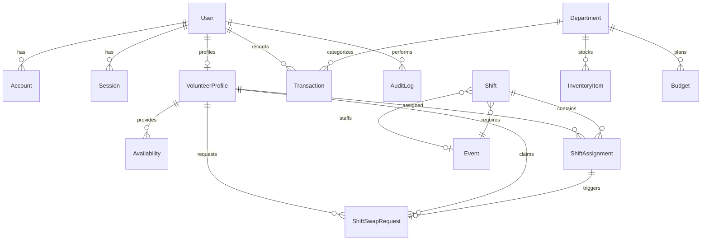

# Liminal Relational Database Design Specification

This document defines the relational database architecture, entity relationships, constraints, and Prisma schema for the Liminal management application.

---

## 1. Entity-Relationship Diagram (ERD)



---

## 2. Core Relational Entities & Data Dictionary

### A. Authentication & Identity
- **`User`**: Base user account for authentication and system permissions.
  - `id`: UUID (Primary Key)
  - `email`: VarChar(255) (Unique)
  - `name`: VarChar(120)
  - `passwordHash`: Text
  - `role`: Enum (`BOARD_ADMIN`, `COORDINATOR`, `BARISTA`, `GENERAL_VOLUNTEER`)
  - `createdAt`, `updatedAt`: Timestamps

### B. Volunteer & Scheduling Domain
- **`VolunteerProfile`**: Domain record extending User with volunteer qualifications.
  - `userId`: UUID (Foreign Key to `User`, Unique)
  - `team`: Enum (`CAFE`, `EVENTS`, `FACILITIES`, `OUTREACH`, `GENERAL`)
  - `tier`: Enum (`WEEKLY_BARISTA`, `CAFE_SUPPORT_POOL`, `OCCASIONAL`, `INACTIVE`)
  - `isCertifiedBarista`: Boolean (Defaults to `false`)
  - `trainingShiftsCompleted`: Integer (Target: >= 2 for certification)
  - `maxWeeklyHours`: Integer (Default: 4)
  - `notes`: Text (Synthetic background notes)
- **`Availability`**: Recurring weekly time windows when volunteer is available.
  - `volunteerId`: UUID (Foreign Key to `VolunteerProfile`)
  - `dayOfWeek`: Integer (0 = Sunday, 1 = Monday ... 6 = Saturday)
  - `startTime`: Time (e.g. `10:00:00`)
  - `endTime`: Time (e.g. `14:00:00`)
- **`Shift`**: Time-bound operational slot requiring staffing.
  - `id`: UUID (Primary Key)
  - `date`: Date
  - `startTime`: Time
  - `endTime`: Time
  - `roleRequired`: Enum (`BARISTA`, `OPENER`, `CLOSER`, `EVENT_DOOR`, `AV_TECH`)
  - `status`: Enum (`SCHEDULED`, `CONFIRMED`, `IN_PROGRESS`, `COMPLETED`, `CANCELLED`, `NEEDS_COVERAGE`)
  - `eventId`: UUID (Optional Foreign Key to `Event` if shift is created for an event)
  - `capacity`: Integer (Default: 1)
- **`ShiftAssignment`**: Junction record mapping volunteer to shift.
  - `shiftId`: UUID (Foreign Key to `Shift`)
  - `volunteerId`: UUID (Foreign Key to `VolunteerProfile`)
  - `status`: Enum (`ASSIGNED`, `CONFIRMED`, `CHECKED_IN`, `COMPLETED`, `NO_SHOW`, `SWAP_REQUESTED`)
  - `checkedInAt`: Timestamp (Nullable)
  - `checkedOutAt`: Timestamp (Nullable)
- **`ShiftSwapRequest`**: Peer-to-peer coverage request.
  - `assignmentId`: UUID (Foreign Key to `ShiftAssignment`)
  - `requesterId`: UUID (Foreign Key to `VolunteerProfile`)
  - `claimedById`: UUID (Optional Foreign Key to `VolunteerProfile`)
  - `status`: Enum (`OPEN`, `CLAIMED`, `APPROVED_BY_COORDINATOR`, `REJECTED`, `EXPIRED`)

### C. Financial & Accounting Domain
- **`Transaction`**: General ledger record for all revenues and expenses.
  - `id`: UUID (Primary Key)
  - `type`: Enum (`REVENUE`, `EXPENSE`)
  - `amountInCents`: Integer (Stores exact financial values without floating point errors)
  - `date`: Date
  - `department`: Enum (`CAFE`, `FACILITIES_RENT_UTILITIES`, `RENOVATION`, `ART_SUPPLIES`, `HARM_REDUCTION`, `EVENTS`, `GENERAL_ADMIN`)
  - `paymentMethod`: Enum (`CASH`, `CARD`, `BANK_TRANSFER`, `ONLINE_DONATION`, `CHECK`)
  - `projectTag`: String (Optional, e.g. `2022_RENOVATION`, `WINTER_DRIVE_2022`)
  - `receiptUrl`: Text (Optional link to digital receipt image/PDF)
  - `description`: Text
  - `createdById`: UUID (Foreign Key to `User`)
- **`Budget`**: Monthly operational targets for variance reporting.
  - `fiscalYear`: Integer
  - `fiscalMonth`: Integer (1-12)
  - `department`: Enum
  - `targetAmountInCents`: Integer

### D. Events & Programming Domain
- **`Event`**: Public and internal workshops, screenings, and gatherings.
  - `id`: UUID (Primary Key)
  - `title`: VarChar(200)
  - `slug`: VarChar(220) (Unique)
  - `description`: Text
  - `category`: Enum (`WORKSHOP`, `FILM_SCREENING`, `LIVE_MUSIC`, `MUTUAL_AID`, `COMMUNITY_MEETING`, `FUNDRAISER`)
  - `startDateTime`: Timestamp
  - `endDateTime`: Timestamp
  - `status`: Enum (`PROPOSED`, `APPROVED`, `SCHEDULED`, `COMPLETED`, `CANCELLED`)
  - `venueVettingStatus`: Enum (`PENDING`, `APPROVED_RIGHT_OF_REFUSAL`, `REJECTED`)
  - `admissionType`: Enum (`FREE`, `PAY_WHAT_YOU_CAN`, `TICKETED_SPLIT`)
  - `proceedsBeneficiary`: String (e.g. `Bail Bond Relief Fund`, `Sonoran Prevention Works`, `Liminal Rent Fund`)
  - `requiredBaristas`: Integer (Default: 0)
  - `requiredEventStaff`: Integer (Default: 1)
  - `externalOrganizerName`: String (Synthetic/Historical)

### E. Inventory & Audit Logging
- **`InventoryItem`**: Physical supplies and reorder thresholds.
  - `id`: UUID (Primary Key)
  - `name`: VarChar(150)
  - `department`: Enum (`CAFE`, `ART_SUPPLIES`, `HARM_REDUCTION`, `FACILITIES`)
  - `currentQuantity`: Integer
  - `unit`: VarChar(50) (e.g. `bags`, `cans`, `kits`, `gallons`)
  - `reorderThreshold`: Integer
- **`HarmReductionLog`**: Anonymous metric tracking for community impact.
  - `id`: UUID (Primary Key)
  - `date`: Date
  - `narcanDosesDistributed`: Integer
  - `saferUseKitsDistributed`: Integer
  - `fentanylTestStripsDistributed`: Integer
  - `notes`: Text
- **`AuditLog`**: Tamper-evident ledger of administrative mutations.
  - `id`: UUID (Primary Key)
  - `userId`: UUID (Foreign Key to `User`)
  - `action`: Enum (`CREATE`, `UPDATE`, `DELETE`, `OVERRIDE_CONFLICT`, `APPROVE_SWAP`)
  - `entityType`: VarChar(50)
  - `entityId`: String
  - `diffJson`: JSONB
  - `createdAt`: Timestamp

---

## 3. Prisma Schema Implementation

```prisma
datasource db {
  provider = "postgresql"
  url      = env("DATABASE_URL")
}

generator client {
  provider = "prisma-client-js"
}

enum Role {
  BOARD_ADMIN
  COORDINATOR
  BARISTA
  GENERAL_VOLUNTEER
}

enum VolunteerTeam {
  CAFE
  EVENTS
  FACILITIES
  OUTREACH
  GENERAL
}

enum VolunteerTier {
  WEEKLY_BARISTA
  CAFE_SUPPORT_POOL
  OCCASIONAL
  INACTIVE
}

enum ShiftRole {
  BARISTA
  OPENER
  CLOSER
  EVENT_DOOR
  AV_TECH
}

enum ShiftStatus {
  SCHEDULED
  CONFIRMED
  IN_PROGRESS
  COMPLETED
  CANCELLED
  NEEDS_COVERAGE
}

enum AssignmentStatus {
  ASSIGNED
  CONFIRMED
  CHECKED_IN
  COMPLETED
  NO_SHOW
  SWAP_REQUESTED
}

enum TransactionType {
  REVENUE
  EXPENSE
}

enum DepartmentType {
  CAFE
  FACILITIES_RENT_UTILITIES
  RENOVATION
  ART_SUPPLIES
  HARM_REDUCTION
  EVENTS
  GENERAL_ADMIN
}

enum PaymentMethod {
  CASH
  CARD
  BANK_TRANSFER
  ONLINE_DONATION
  CHECK
}

enum EventCategory {
  WORKSHOP
  FILM_SCREENING
  LIVE_MUSIC
  MUTUAL_AID
  COMMUNITY_MEETING
  FUNDRAISER
}

enum EventStatus {
  PROPOSED
  APPROVED
  SCHEDULED
  COMPLETED
  CANCELLED
}

model User {
  id               String            @id @default(uuid())
  email            String            @unique
  name             String
  passwordHash     String
  role             Role              @default(GENERAL_VOLUNTEER)
  volunteerProfile VolunteerProfile?
  transactions     Transaction[]
  auditLogs        AuditLog[]
  createdAt        DateTime          @default(now())
  updatedAt        DateTime          @updatedAt
}

model VolunteerProfile {
  id                      String            @id @default(uuid())
  userId                  String            @unique
  user                    User              @relation(fields: [userId], references: [id], onDelete: Cascade)
  team                    VolunteerTeam     @default(GENERAL)
  tier                    VolunteerTier     @default(CAFE_SUPPORT_POOL)
  isCertifiedBarista      Boolean           @default(false)
  trainingShiftsCompleted Int               @default(0)
  maxWeeklyHours          Int               @default(4)
  notes                   String?
  availabilities          Availability[]
  assignments             ShiftAssignment[]
  requestedSwaps          ShiftSwapRequest[] @relation("Requester")
  claimedSwaps            ShiftSwapRequest[] @relation("Claimant")
  createdAt               DateTime          @default(now())
  updatedAt               DateTime          @updatedAt
}

model Availability {
  id          String           @id @default(uuid())
  volunteerId String
  volunteer   VolunteerProfile @relation(fields: [volunteerId], references: [id], onDelete: Cascade)
  dayOfWeek   Int              // 0 (Sun) to 6 (Sat)
  startTime   String           // HH:mm
  endTime     String           // HH:mm
}

model Shift {
  id           String            @id @default(uuid())
  date         DateTime          @db.Date
  startTime    String            // HH:mm
  endTime      String            // HH:mm
  roleRequired ShiftRole         @default(BARISTA)
  status       ShiftStatus       @default(SCHEDULED)
  capacity     Int               @default(1)
  eventId      String?
  event        Event?            @relation(fields: [eventId], references: [id], onDelete: SetNull)
  assignments  ShiftAssignment[]
  createdAt    DateTime          @default(now())
  updatedAt    DateTime          @updatedAt

  @@index([date])
}

model ShiftAssignment {
  id           String            @id @default(uuid())
  shiftId      String
  shift        Shift             @relation(fields: [shiftId], references: [id], onDelete: Cascade)
  volunteerId  String
  volunteer    VolunteerProfile  @relation(fields: [volunteerId], references: [id], onDelete: Cascade)
  status       AssignmentStatus  @default(ASSIGNED)
  checkedInAt  DateTime?
  checkedOutAt DateTime?
  swapRequest  ShiftSwapRequest?
  createdAt    DateTime          @default(now())
  updatedAt    DateTime          @updatedAt

  @@unique([shiftId, volunteerId])
}

model ShiftSwapRequest {
  id           String           @id @default(uuid())
  assignmentId String           @unique
  assignment   ShiftAssignment  @relation(fields: [assignmentId], references: [id], onDelete: Cascade)
  requesterId  String
  requester    VolunteerProfile @relation("Requester", fields: [requesterId], references: [id])
  claimedById  String?
  claimant     VolunteerProfile? @relation("Claimant", fields: [claimedById], references: [id])
  status       String           @default("OPEN") // OPEN, CLAIMED, APPROVED, REJECTED
  createdAt    DateTime         @default(now())
  updatedAt    DateTime         @updatedAt
}

model Transaction {
  id            String          @id @default(uuid())
  type          TransactionType
  amountInCents Int
  date          DateTime        @db.Date
  department    DepartmentType
  paymentMethod PaymentMethod   @default(CARD)
  projectTag    String?
  receiptUrl    String?
  description   String
  createdById   String
  createdBy     User            @relation(fields: [createdById], references: [id])
  createdAt     DateTime        @default(now())
  updatedAt     DateTime        @updatedAt

  @@index([date, department])
}

model Event {
  id                   String        @id @default(uuid())
  title                String
  slug                 String        @unique
  description          String
  category             EventCategory
  startDateTime        DateTime
  endDateTime          DateTime
  status               EventStatus   @default(SCHEDULED)
  venueVettingApproved Boolean       @default(true)
  admissionType        String        @default("PAY_WHAT_YOU_CAN")
  proceedsBeneficiary  String?
  requiredBaristas     Int           @default(0)
  requiredEventStaff   Int           @default(1)
  externalOrganizer    String?
  shifts               Shift[]
  createdAt            DateTime      @default(now())
  updatedAt            DateTime      @updatedAt
}

model InventoryItem {
  id               String         @id @default(uuid())
  name             String
  department       DepartmentType
  currentQuantity  Int            @default(0)
  unit             String         @default("units")
  reorderThreshold Int            @default(5)
  updatedAt        DateTime       @updatedAt
}

model HarmReductionLog {
  id                             String   @id @default(uuid())
  date                           DateTime @db.Date
  narcanDosesDistributed         Int      @default(0)
  saferUseKitsDistributed        Int      @default(0)
  fentanylTestStripsDistributed  Int      @default(0)
  notes                          String?
}

model AuditLog {
  id         String   @id @default(uuid())
  userId     String
  user       User     @relation(fields: [userId], references: [id])
  action     String
  entityType String
  entityId   String
  diffJson   Json?
  createdAt  DateTime @default(now())

  @@index([entityType, entityId])
}
```

---

## 4. Synthetic Seed Data Strategy

To maintain strict data privacy:
1. **Zero Real Volunteers**: Generate 15–20 realistic synthetic volunteer accounts representing diverse Flagstaff locals (*"Taylor S.", "Jordan M.", "Alex K."*).
2. **Realistic Historical Shifts**: Seed recurring shifts matching the authentic schedule (Wed–Sun 10am–2pm and 2pm–6pm) across historical months, including:
   - Certified Weekly Baristas in recurring slots.
   - 2 pending ShiftSwapRequests demonstrating coverage workflows.
   - Conflict scenarios (e.g., overlapping shift request) to test the conflict detection engine.
3. **Ledger Data Inspired by Reality**:
   - Monthly fixed rent expenses (\$3,000/month).
   - Cafe supply purchases with receipts attached.
   - Pay-what-you-can daily coffee donations ($50–$180/day).
   - Historical fundraiser proceeds (e.g. *Wrecking Ball Bail Fundraiser*, *Winter Clothing Drive*).

