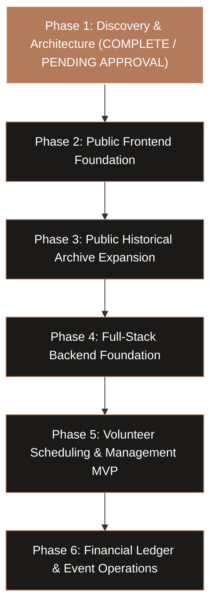

# Liminal Project Development Roadmap

This roadmap defines the sequential, iterative execution plan for building the Liminal public historical website and administrative management application.

---

## Phase Overview & Approval Boundaries

---

## Detailed Phase Breakdown

### Phase 1 — Discovery & Planning (Current Phase)
- **Status**: Completed; comprehensive documentation created; awaiting user approval.
- **Key Deliverables**:
  - `docs/resource-inventory.md`: Complete audit of all 35 Squarespace screenshots, original website code, and Google Drive archives; sensitive privacy flags documented.
  - `docs/historical-content.md`: Verified historical facts, timelines, facilities, events, and cafe menus with source citations.
  - `docs/design-reference.md`: Exact design system translating Squarespace aesthetic (colors, typography, components, layouts).
  - `docs/operational-workflows.md`: Detailed translation of historical volunteer, financial, and event practices into software requirements.
  - `docs/architecture.md`: Full-stack technical stack, monorepo boundaries, NestJS readiness, and security design.
  - `docs/database-design.md`: ERD, relational schema, and Prisma schema.
  - `docs/development-roadmap.md`: Iterative milestones and verification criteria.
- **Stop Boundary**: Presentation of findings and approval before installing dependencies or writing application code.

---

### Phase 2 — Public Frontend Foundation
- **Objective**: Establish the modern Next.js application, implement the design system tokens, and construct the responsive Homepage matching the Squarespace visual reference.
- **Milestones**:
  1. Initialize Next.js 15 with TypeScript, Tailwind CSS, and ESLint (`create-next-app`).
  2. Configure Tailwind with custom Liminal tokens (`charcoal-950`, `terracotta-500`, `peach-300`, `olive-800`, `cream-50`) and load fonts (`Montserrat` / `Inter`).
  3. Build accessible layout primitives:
     - `Header`: Liminal bench-and-plant logo, responsive navigation links, mobile drawer.
     - `ArchiveBanner`: Prominent, dignified banner establishing the site as a 2021–2023 historical archive.
     - `Footer`: Historical operating hours, 217 S San Francisco St location, contact info, archive credits.
  4. Implement the Homepage (`src/app/(public)/page.tsx`):
     - Terracotta Hero Banner: *"A People's Cafe & Community Center"*.
     - Historical operating hours & location callout with interior podcast photo.
     - Interactive circular-image Community Resources Carousel (donation cafe, workspace, art supplies, radical library, harm reduction).
     - Volunteer CTA with masked photo: *"Interested in volunteering with us?"*.
     - Mission Support & Donation section with cafe interior image.
  5. Add subtle interactive micro-interactions (smooth carousel transitions, accessible link hovers, active tab indicators).
- **Verification Criteria**:
  - `npm run build` succeeds without TypeScript or styling warnings.
  - Responsive verification across mobile (375px), tablet (768px), and desktop (1280px+).

---

### Phase 3 — Public Historical Archive Expansion
- **Objective**: Implement the full suite of public archive pages with structured content models and authentic historical media.
- **Milestones**:
  1. **Our Story (`/our-story`)**:
     - Founding narrative, critique of commercial spaces, definition of "liminal", building exterior photography.
  2. **Facilities Tour (`/facilities`)**:
     - Alternating photo/text blocks showcasing Cafe Bar, Art Supply Room, Radical Library, and Multimedia Room.
  3. **Historical Cafe Menu (`/menu`)**:
     - Interactive menu cards detailing beverages, small plates (with partner *Evolve Eats*), and the "Pay High // Pay Low" community equity explanation.
  4. **Programming & Event Archive (`/programming`)**:
     - Filterable archive of historical events by category (Narcan Trainings, IWW Movie Nights, Wrecking Ball, Jazz Jams, Art Workshops).
     - Digital flyer gallery with modal viewer.
  5. **Photo & Document Archive (`/archive`)**:
     - Categorized photo gallery with lightbox viewer and historical context captions.
- **Verification Criteria**:
  - All public navigation links resolve with semantic metadata.
  - Zero placeholder "lorem ipsum"; all copy sourced directly from historical records.

---

### Phase 4 — Backend Foundation & Authentication
- **Objective**: Initialize the database, migrations, authentication layer, and domain services.
- **Milestones**:
  1. Configure PostgreSQL connection and initialize Prisma ORM.
  2. Apply initial database migrations for `User`, `VolunteerProfile`, `Shift`, `ShiftAssignment`, `Transaction`, `Event`, and `AuditLog`.
  3. Seed synthetic demonstration data (`prisma/seed.ts`) with realistic, privacy-safe records.
  4. Integrate Auth.js (NextAuth v5) with credential login and database sessions.
  5. Implement role-based authorization middleware protecting `/admin/*`.
  6. Establish domain service classes (`src/server/services/`) with pure TypeScript business logic.
- **Verification Criteria**:
  - `npx prisma migrate dev` and `npx prisma db seed` execute cleanly.
  - Vitest integration tests verify RBAC access boundaries and credential hashing.

---

### Phase 5 — Volunteer Scheduling MVP
- **Objective**: Deliver the core administrative volunteer scheduling engine, conflict detection, and self-service coverage marketplace.
- **Milestones**:
  1. **Admin Volunteer Roster (`/admin/volunteers`)**:
     - Volunteer directory displaying team, tier, barista certification status, and training shifts completed.
     - Create and edit volunteer profiles.
  2. **Shift Calendar & Management (`/admin/schedule`)**:
     - Monthly, weekly, and daily calendar views of cafe shifts (Wed–Sun 10am–2pm and 2pm–6pm).
     - Shift assignment modal with live availability checking.
  3. **Scheduling Conflict Detection Engine**:
     - Automated detection of:
       - Overlapping shift assignments.
       - Volunteers exceeding max weekly hours (e.g. > 4 hours).
       - Uncertified volunteers assigned to solo barista shifts.
     - Visual warning badges and coordinator override capability with audit logging.
  4. **Shift Swap & Open Shift Marketplace (`/admin/swaps` / Volunteer Portal)**:
     - Baristas can request shift coverage.
     - Eligible Cafe Support pool volunteers can view and claim open slots.
- **Verification Criteria**:
  - Vitest unit tests verifying conflict detection edge cases.
  - Playwright test covering shift creation, assignment, conflict trigger, and swap claim.

---

### Phase 6 — Financial Ledger, Event Operations & Polish
- **Objective**: Complete the administrative operational suite with financial reporting, event lifecycle management, and end-to-end polish.
- **Milestones**:
  1. **Financial Management Dashboard (`/admin/finances`)**:
     - Transaction ledger table with department filtering, project tags, and receipt attachment links.
     - Monthly variance reports comparing actual spending against the \$3,000/mo rent baseline.
     - CSV export and import utilities.
  2. **Event Management & Staffing (`/admin/events`)**:
     - Event proposal review pipeline and Right of Refusal vetting checklist.
     - Automatic creation of volunteer shifts attached to scheduled events.
     - Google Calendar API sync / iCal export.
  3. **Admin Dashboard Overview (`/admin/dashboard`)**:
     - Aggregated KPIs: upcoming open shifts, volunteer coverage gaps, monthly financial health, and upcoming events.
  4. **End-to-End Verification**:
     - Comprehensive Playwright test suite running across public and administrative journeys.
     - Performance audit (Lighthouse >= 95 for SEO, Accessibility, Performance).

